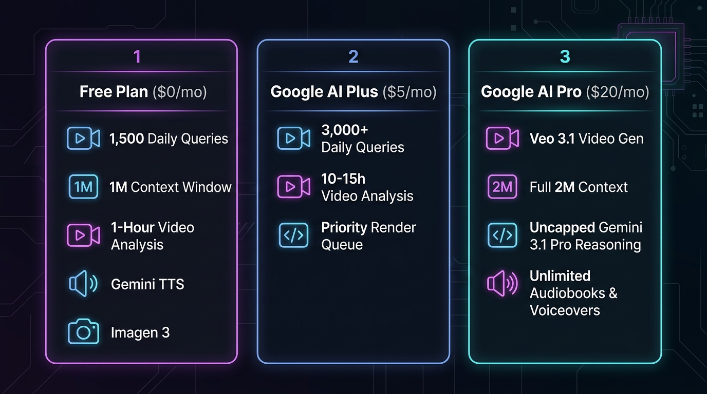

# 🎟️ Gemini Media Pass MCP

> **The All-Access Google Media & Multimodal MCP Super-Server for Claude, Hermes, Codex, and Cursor.**  
> Native Video Analysis, Google Flow (Veo 3.1) Video Studio, Google Stitch UI Engine, Flow Music, Imagen 3, Gemini TTS, 2M Document Context, and Gemini Pro Reasoning.

[](https://opensource.org/licenses/MIT)
[](https://www.python.org/downloads/)
[](https://modelcontextprotocol.io/)
[](https://deepmind.google/technologies/veo/)

---

## 💡 What is Gemini Media Pass?

While Claude, Hermes, and Codex are elite reasoning and coding agents, they lack native video comprehension, AI video rendering, UI canvas design, and direct audio synthesis.

**Gemini Media Pass gives your agents an all-access pass to Google's creative and multimodal intelligence stack through a single MCP server**:

- 🎬 **Video Understanding & Flow Analysis** — Ingest raw `.mp4`, `.mov`, `.webm` files. Reviews camera transitions, cut pacing, B-roll timing, and subtitle flow without blowing up context windows.
- 🎥 **Google Flow: Veo 3.1 AI Video Generation** — Render cinematic AI videos (`9:16` vertical or `16:9` widescreen, 4s/6s/8s/10s, Text-to-Video & Image-to-Video) using your Google AI subscription credits.
- 🔄 **Video Extension & Cloud Project Retrieval** — Extend clips by +8s, list your cloud projects on `flow.google.com`, and download past creations by media ID.
- 📱 **Google Stitch: AI UI Design Studio** — Generate mobile/desktop app screens, extract Tailwind/HTML code, and enforce brand design systems directly from chat.
- 🎵 **Flow Music & Soundtracks** — Compose backing tracks, instrumental beats, and ambient soundscapes via Google Flow Music / MusicFX.
- 🗣️ **Gemini Text-to-Speech (TTS)** — Speak scripts aloud into `.mp3`/`.wav` using Gemini's native audio generation with 5 voice personas (`Puck`, `Charon`, `Kore`, `Fenrir`, `Aoede`) plus offline neural fallback.
- 🎨 **Imagen 3 Image Generation** — Generate photorealistic graphics and marketing assets across 7 aspect ratios (`1:1`, `16:9`, `9:16`, `4:3`, `3:4`, `3:2`, `2:3`).
- 📚 **2,000,000 Token Document Reading** — Drop massive PDFs, enterprise logs, or 70,000-line codebases into Gemini's 2M-token window.
- 🧠 **Dual-Model Delegation** — Offload deep algorithmic proofs to Gemini 3.1 Pro or batch tasks to Gemini 3.8 Flash.

---

## 🔑 Authentication: How It Connects & Accesses Your Creations

### **Do I need to create a special Antigravity account?**
**No!** There is no separate "Antigravity account." You simply sign in with your regular Google Account (`@gmail.com` or Google Workspace). 

### **Is a Free Account eligible?**
**Yes, 100%!** Any standard free Google account is eligible out of the box with zero credit cards required.

---

### Hybrid Dual-Mode Authentication

Gemini Media Pass gives you access to both your personal saved libraries and optional API keys:

```text
┌─────────────────────────────────────────────────────────────────────────────┐
│                          GEMINI MEDIA PASS AUTH ENGINE                      │
├──────────────────────────────────────┬──────────────────────────────────────┤
│ 👤 Mode A: Personal Account Session  │ 🔑 Mode B: API Key / Headless Mode   │
│    (Default & Recommended)           │    (Optional Developer Override)     │
├──────────────────────────────────────┼──────────────────────────────────────┤
│ • Auto-detected via Google login     │ • Set GEMINI_API_KEY / STITCH_KEY    │
│ • Full access to saved projects,     │ • Works in headless Docker / CI      │
│   past videos, and Stitch screens    │ • Pure model inference without       │
│ • Reuses your $20/mo sub credits     │   needing interactive browser sign-in│
└──────────────────────────────────────┴──────────────────────────────────────┘
```

* **Accessing Creations in Google Flow & Stitch:** Past creations, projects, and cloud assets are tied to your personal Google account. Logging in via `gemini-media-pass-login` allows tools like `flow_list_projects`, `flow_download_media`, and `stitch_list_projects` to retrieve your actual dashboard assets.
* **API Key Override:** If running headless on a server, set `GEMINI_API_KEY` in your environment.

---

## ❓ Plan Tiers: Free ($0) vs. Google AI Plus ($5/mo) vs. Google AI Pro ($20/mo)

### **You can use the Free Plan! No paid subscription is required.**

Gemini Media Pass supports all three Google ecosystem tiers, allowing users to start for $0 and scale up as their workload grows:

| Resource / Feature | 🆓 Free Plan | ⚡ Google AI Plus (~$5/mo) | 💎 Google AI Pro ($20/mo) |
|---|---|---|---|
| **Monthly Cost** | **$0 / Free** (No credit card) | **~$5 / month** (Starter AI Tier) | **$20 / month** (Google One AI Premium) |
| **Daily Request Limit** | **Up to 1,500 queries / day** (15 req/min) | **3,000+ queries / day** (30 req/min) | 🚀 **High-throughput enterprise priority** |
| **Max Context Window** | **1,000,000 tokens** per query | **1,000,000 tokens** per query | **2,000,000 tokens** per query |
| **Video Understanding** | **Up to ~1 hr video / query** (~900k tokens) | **Up to ~1 hr video / query** (faster queue) | **Up to ~2 hrs video in a single query** |
| **Daily Video Capacity** | **~3–5 hours total video / day** | **~10–15 hours total video / day** | **Continuous automated batch video** |
| **Veo 3.1 AI Video Gen** | Standard draft limits | Priority render queue | **Included monthly Veo credit pool** |
| **Text-to-Speech (TTS)** | **~20–40 mins audio / day** + Neural | **~2–3 hours finished audio / day** | **Unlimited voiceovers & audiobooks** |
| **Flow Music Gen** | Background loops & beats | Faster generation queue | High-throughput soundtrack scoring |
| **Imagen 3 Image Gen** | **~30–50 images / day** (standard caps) | **~150–200 images / day** | **500+ images / day** (high-volume) |
| **Google Stitch UI Studio** | Component scaffolding & layouts | Multi-screen parallel projects | Unlimited design systems & tokens |
| **Document Reading** | **~500-page PDFs / 35k lines code** | **~500-page PDFs** (higher concurrency) | **1,000+ page docs / 70k lines code** |
| **Gemini 3.8 Flash** | **1,500 calls / day** (fast) | **3,000+ calls / day** (faster) | 🚀 **Top priority queue** |
| **Gemini 3.1 Pro** | **~50 reasoning queries / day** | **~200–300 queries / day** | 🧠 **Uncapped deep reasoning** |
| **Authentication** | Google login (Free) OR `GEMINI_API_KEY` | Google login OR Cloud Pay-As-You-Go | `gemini-media-pass-login` with subscribed account |

<p align="center">
  
</p>

---

## 🎯 Real-World Production Limits: What Can You Actually Build?

### 1. 🎬 Video Understanding (`gemini_video`)
* **On Free ($0):** Review **20–30 short-form clips** (TikToks, Reels, Shorts) or **3–5 full 20-minute YouTube tutorials** daily. Single videos can be up to 45–60 minutes long.
* **On AI Plus (~$5/mo):** Review **50+ short-form clips** or **10–15 full YouTube videos** daily with halved queue latency.
* **On AI Pro ($20/mo):** Continuous automated QA pipelines. Ingest an entire **2-hour raw podcast recording, conference lecture, or gameplay stream in a single prompt** (using the full 2M token window).

### 2. 🎥 Google Flow: Veo 3.1 Video Studio (`flow_generate_video`, `flow_extend_video`)
* **Veo Fast (20 credits):** Render 4s/6s/8s clips in `9:16` or `16:9`.
* **Veo Quality (40 credits):** Maximum visual fidelity, complex cinematic camera motion, realistic lighting.
* **Omni Flash (20 credits):** Generates AI video with synchronized **native audio** (speech, sound effects, ambient noise).
* **Video Extension (+8s, 20 credits):** Extend clips seamlessly while preserving characters, style, and motion continuity.

### 3. 🗣️ Text-to-Speech Generation (`gemini_text_to_speech`)
* **On Free ($0):** Generate **15,000–30,000 spoken words per day** (about 20–40 minutes of finished narration) via Gemini Audio, plus unlimited keyless voice synthesis via the built-in Neural Fallback engine.
* **On AI Plus (~$5/mo):** Generate **100,000+ spoken words per day** (roughly 2–3 hours of finished audio daily) for multi-chapter video essays and courses.
* **On AI Pro ($20/mo):** Uncapped generation for **full audiobook publishing**, interactive voice agents, and in-game NPC dialogue.

### 4. 🎨 Imagen 3 Image Generation (`gemini_generate_image`)
* **On Free ($0):** Generate **~30–50 high-resolution images daily** across all 7 aspect ratios.
* **On AI Plus (~$5/mo):** Generate **~150–200 images daily** with priority queue speed.
* **On AI Pro ($20/mo):** Generate **500+ images daily**. Perfect for game texture libraries, multivariate ad creatives, and rapid design sprints.

---

## 📊 Token Savings: Claude vs. Gemini Media Pass

Claude cannot read video files natively. In order for Claude to "see" a video, frames must be extracted as static images:

| Video Length | Claude Frame Extraction (1 fps) | Gemini Media Pass External Processing | Claude Tokens Saved | Cost / Context Impact |
|---|---|---|---|---|
| **30 Seconds** | 30 images = **48,000 tokens** | **~500 tokens** (markdown report) | **~47,500 tokens** | Saves ~$0.15 |
| **2 Minutes** | 120 images = **192,000 tokens** *(Near 200k limit!)* | **~750 tokens** (markdown report) | **~191,250 tokens** | Saves Claude context crash (~$0.58) |
| **5 Minutes** | 300 images = **480,000 tokens** *(CRASHES Claude)* | **~1,000 tokens** (markdown report) | **479,000 tokens** | Prevents context overflow |
| **15 Minutes** | 900 images = **1,440,000 tokens** *(Impossible)* | **~1,200 tokens** (markdown report) | **1,438,800 tokens** | Unlocks impossible workflows |

---

## 🛠️ Complete Tool Inventory (24 Tools)

### 👁️ Multimodal Understanding & Analysis (Gemini Flash / Pro)
| Tool | Parameters | Description |
|---|---|---|
| `gemini_video` | `video_path`, `question` | Watch & analyze video files (`.mp4`, `.mov`, `.webm`, `.mkv`). Inspects temporal scene flow, cut pacing, B-roll timing, camera movement, and on-screen text. |
| `gemini_vision` | `image_path`, `question` | Inspect UI screenshots, wireframes, architectural diagrams, and photos with high-precision multimodal vision. |
| `gemini_audio` | `audio_path`, `question` | Listen to and analyze raw audio (`.mp3`, `.wav`, `.m4a`). Transcribes speech, critiques vocal delivery/pacing, identifies emotion/tone, and flags background sounds. |
| `gemini_read_document` | `file_path`, `question` | Ingest massive documents, books, compliance manuals, and logs using Gemini's 2,000,000 token context window. |
| `gemini_multimodal_inspect` | `file_path`, `question` | Universal router: automatically inspects any media file (video, audio, image, PDF, or code) and returns a detailed analysis. |
| `ask_gemini_pro` | `prompt` | Delegate complex tasks to Google Gemini 3.1 Pro. Deep multi-step reasoning, mathematical proofs, alternative architecture options, and second opinions. |
| `ask_gemini_flash` | `prompt` | High-speed task delegation to Google Gemini 3.8 Flash. Low latency, rapid extraction, and batch operations. |

### 🎙️ Voice & Audio Generation
| Tool | Parameters | Description |
|---|---|---|
| `gemini_text_to_speech` | `text`, `voice`, `output_path`, `style_instruction` | Convert text and scripts into high-quality spoken audio (`.mp3` / `.wav`) using Gemini multimodal audio output or neural speech. Supports voices: `Puck`, `Charon`, `Kore`, `Fenrir`, `Aoede`. |
| `flow_generate_music` | `prompt`, `duration`, `output_path` | Compose background music, instrumental beats, and ambient soundscapes via Google Flow Music / MusicFX. |

### 🎨 Visual & Creative Generation
| Tool | Parameters | Description |
|---|---|---|
| `gemini_generate_image` | `prompt`, `aspect_ratio`, `image_name` | Generate photorealistic images and concept art via Google Imagen across 7 aspect ratios (`1:1`, `16:9`, `9:16`, `4:3`, `3:4`, `3:2`, `2:3`). |

### 🎬 Google Flow: Veo 3.1 Video Studio & Asset Retrieval
| Tool | Parameters | Description |
|---|---|---|
| `flow_generate_video` | `prompt`, `orientation`, `duration`, `model`, `mode`, `initial_frame`, `end_frame` | Generate cinematic AI videos using Google Flow (**Veo 3.1** & **Omni Flash** with native audio). Supports `9:16` vertical & `16:9` widescreen, 4s/6s/8s/10s, Text-to-Video and Image-to-Video. Feeds live credit balances. |
| `flow_extend_video` | `media_id`, `prompt`, `project_id`, `orientation` | Extends an existing Google Flow video by an extra +8 seconds with continuous motion and sound. |
| `flow_list_projects` | `limit` | List your existing Google Flow projects and folders created on `flow.google.com` or via CLI. |
| `flow_download_media` | `media_id`, `output_path` | Fetch an already-generated video or audio asset from Google Flow by its media ID directly into your local workspace. |
| `flow_sync_catalog` | None | Reconcile and sync your local media catalog with your remote Google Flow project history. |
| `flow_get_credits` | `force_refresh` | Check live Google Flow credit balance, monthly subscription pool, and daily burn rate with milestone alerts. |
| `flow_list_models` | None | Displays all available video models (`veo-fast`, `veo-quality`, `veo-lite`, `omni-flash`) and their credit costs. |
| `flow_auth_status` | None | Checks Google Flow session health and verifies the connected Google account. |

### 📱 Google Stitch: AI UI Design Studio
| Tool | Parameters | Description |
|---|---|---|
| `stitch_generate_screen` | `project_id`, `prompt`, `device_type`, `design_system_id` | Generate a new mobile or desktop UI screen and frontend code in a Google Stitch project from a text prompt. |
| `stitch_list_projects` | `filter` | Lists all Google Stitch UI design projects owned by or shared with your Google account. |
| `stitch_create_project` | `title` | Creates a new Google Stitch project container for app screens, design systems, and frontend code. |
| `stitch_list_screens` | `project_id` | List all screens, UI mockups, and components inside a specific Google Stitch project. |
| `stitch_get_screen` | `project_id`, `screen_id` | Retrieve the full UI layout, components, and code for an existing screen inside a Google Stitch project. |
| `stitch_apply_design_system` | `project_id`, `design_system_id` | Apply an existing design system (color tokens, typography, layout specs) to a Google Stitch project. |

---

## 🚀 Quickstart & Setup

### 1. Interactive One-Time Google Login (For Flow & Stitch)

```bash
gemini-media-pass-login
```
*(Or run `python -m gemini_media_pass_mcp.auth`). A Chrome window opens to sign into your Google account, linking your Google Flow credits and personal asset libraries.*

---

### 2. Configure Claude Desktop

Add Gemini Media Pass to your `claude_desktop_config.json`:

* **Windows:** `%APPDATA%\Claude\claude_desktop_config.json`
* **macOS:** `~/Library/Application Support/Claude/claude_desktop_config.json`

```json
{
  "mcpServers": {
    "gemini-media-pass": {
      "command": "uvx",
      "args": [
        "git+https://github.com/<your-username>/gemini-media-pass"
      ]
    }
  }
}
```

---

### 3. Configure Claude Code (CLI)

```bash
claude mcp add gemini-media-pass -- uvx git+https://github.com/<your-username>/gemini-media-pass
```

---

### 4. Configure Codex / Cursor / Windsurf

In your IDE's **Settings** -> **Features** -> **MCP Servers** -> **Add New MCP Server**:
- **Name:** `gemini-media-pass`
- **Type:** `command`
- **Command:** `uvx git+https://github.com/<your-username>/gemini-media-pass`

---

### 5. Configure Hermes Agent

Add to your Hermes `config.yaml` or MCP section:
```yaml
mcp_servers:
  gemini_media_pass:
    command: uvx
    args:
      - "git+https://github.com/<your-username>/gemini-media-pass"
```

---

## 📦 Local Development

```bash
git clone https://github.com/<your-username>/gemini-media-pass.git
cd gemini-media-pass
pip install -e .
```

Verify all 24 tools:
```bash
python -c "from gemini_media_pass_mcp.server import mcp; print(len(mcp._tool_manager._tools), 'tools active')"
```

---

## 📄 License

MIT License. See [LICENSE](LICENSE) for details.
