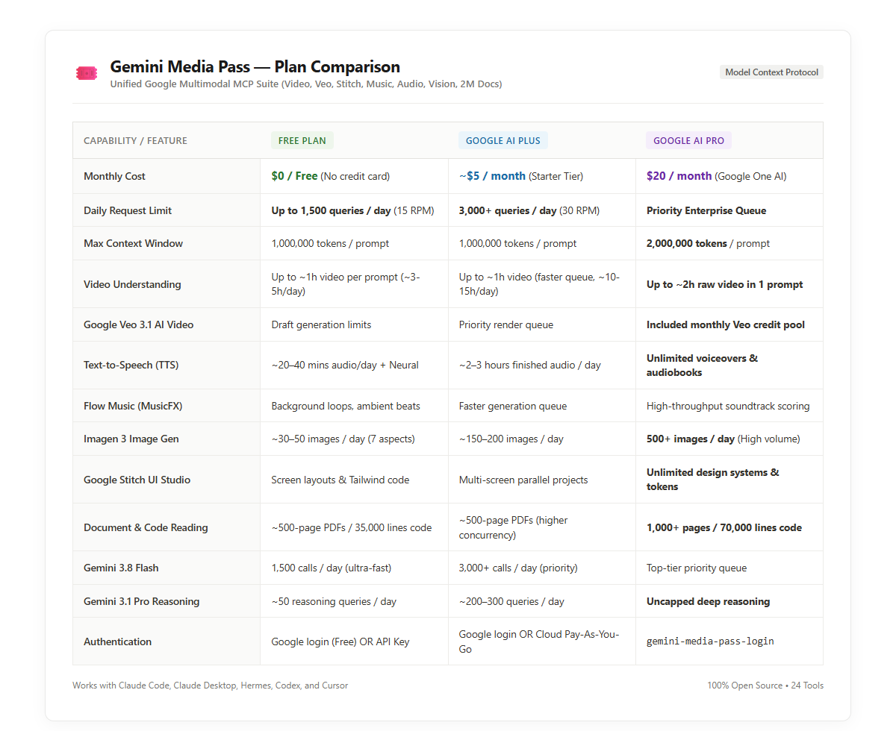

# 🎟️ Gemini Media Pass MCP

> **The All-Access Google Media & Multimodal MCP Super-Server for Claude, Hermes, Codex, and Cursor.**  
> Native Video Analysis, Google Flow (Veo 3.1) Video Studio, Google Stitch UI Engine, Flow Music, Imagen 3, Gemini TTS, 2M Document Context, and Gemini Pro Reasoning.

[](https://opensource.org/licenses/MIT)
[](https://www.python.org/downloads/)
[](https://modelcontextprotocol.io/)
[](https://deepmind.google/technologies/veo/)

---

## 💡 What is Gemini Media Pass?

While Claude, Hermes, and Codex are elite reasoning and coding agents, they lack native video comprehension, AI video rendering, UI canvas design, and direct audio synthesis.

**Gemini Media Pass gives your agents an all-access pass to Google's creative and multimodal intelligence stack through a single MCP server**:

- 🎬 **Video Understanding & Flow Analysis** — Ingest raw `.mp4`, `.mov`, `.webm` files. Reviews camera transitions, cut pacing, B-roll timing, and subtitle flow without blowing up context windows.
- 🎥 **Google Flow: Veo 3.1 AI Video Generation** — Render cinematic AI videos (`9:16` vertical or `16:9` widescreen, 4s/6s/8s/10s, Text-to-Video & Image-to-Video) using your Google AI subscription credits.
- 🔄 **Video Extension & Cloud Project Retrieval** — Extend clips by +8s, list your cloud projects on `flow.google.com`, and download past creations by media ID.
- 📱 **Google Stitch: AI UI Design Studio** — Generate mobile/desktop app screens, extract Tailwind/HTML code, and enforce brand design systems directly from chat.
- 🎵 **Flow Music & Soundtracks** — Compose backing tracks, instrumental beats, and ambient soundscapes via Google Flow Music / MusicFX.
- 🗣️ **Gemini Text-to-Speech (TTS)** — Speak scripts aloud into `.mp3`/`.wav` using Gemini's native audio generation with 5 voice personas (`Puck`, `Charon`, `Kore`, `Fenrir`, `Aoede`) plus offline neural fallback.
- 🎨 **Imagen 3 Image Generation** — Generate photorealistic graphics and marketing assets across 7 aspect ratios (`1:1`, `16:9`, `9:16`, `4:3`, `3:4`, `3:2`, `2:3`).
- 📚 **2,000,000 Token Document Reading** — Drop massive PDFs, enterprise logs, or 70,000-line codebases into Gemini's 2M-token window.
- 🧠 **Dual-Model Delegation** — Offload deep algorithmic proofs to Gemini 3.1 Pro or batch tasks to Gemini 3.8 Flash.

---

## 🛡️ Security & Authentication: Two Safe Ways to Connect

We built Gemini Media Pass with **security and privacy as first-class citizens**. You choose how you want to connect:

### 🔒 Option 1: Zero-Trust Official API Key (Recommended for Privacy-Conscious Developers)
If you don't want to log in through a browser or connect your personal Google session, simply generate a free API key at [aistudio.google.com](https://aistudio.google.com) (no credit card needed).

* **100% Sandboxed:** Scoped strictly to inference. Never touches your personal Gmail, Google Drive, or account tokens.
* **Revocable in 1-Click:** Delete or cycle the key anytime in Google AI Studio.
* **Setup:** Drop it in a `.env` file (`GEMINI_API_KEY=AIza...`) or pass it directly in your Claude Desktop / Cursor MCP config:
  ```json
  "env": {
    "GEMINI_API_KEY": "AIzaSy..."
  }
  ```
* **What it powers:** Video analysis, Vision, Audio critique, Gemini TTS, Imagen 3, 2M document context, and Pro/Flash reasoning.

---

### 🌐 Option 2: Consumer Google Account Session (`gemini-media-pass-login`)
Only needed if you specifically want to drive **Google Flow (Veo 3.1 AI Video Generation)** using your personal consumer Google AI Pro subscription credits or browse your saved cloud projects:

* **How it works:** Run `gemini-media-pass-login`. An official Google Chrome window opens to sign into `flow.google.com`.
* **Where tokens are stored:** Credentials are saved locally on your own machine in `~/.gflow` (never sent to third-party servers).
* **What it unlocks:** Veo 3.1 video generation, clip extensions, Flow credit tracking, and downloading past cloud creations.

---

## ❓ Plan Tiers: Free ($0) vs. Google AI Plus ($5/mo) vs. Google AI Pro ($20/mo)

### **You can use the Free Plan! No paid subscription is required.**

Gemini Media Pass supports all three Google ecosystem tiers, allowing users to start for $0 and scale up as their workload grows:

| Resource / Feature | 🆓 Free Plan | ⚡ Google AI Plus (~$5/mo) | 💎 Google AI Pro ($20/mo) |
|---|---|---|---|
| **Monthly Cost** | **$0 / Free** (No credit card needed) | **~$5 / month** (Starter AI Tier) | **$20 / month** (Google One AI Premium) |
| **Daily Questions & Tasks** | **1,500 questions / day** (~1 every 4 sec) | **3,000+ questions / day** (~2 req/sec) | 🚀 **Unlimited / Instant priority queue** |
| **Memory per Prompt (Context)** | **750,000 words** (~1,500 book pages) | **750,000 words** (~1,500 book pages) | **1,500,000 words** (~3,000 book pages) |
| **Claude Token Saver** | **Reads 500-page PDFs / 35k lines code** (Saves 100% of Claude tokens) | **Reads 500-page PDFs** (Fast parallel processing) | **Reads 1,000+ pages / 70k lines** in a single pass |
| **Video Understanding** | **1-hour video clip / prompt** (~3–5 hrs analyzed/day) | **1-hour video clip / prompt** (~10–15 hrs analyzed/day) | **Up to 2-hour video clip** (~30+ hrs analyzed/day) |
| **Veo 3.1 AI Video Generation** | **10–20 credits** (~1–2 preview clips) | **~100 credits / month** (~10 full videos or 20 extensions) | **~1,000 credits / month** (~100 videos or 200 extensions) |
| **Text-to-Speech (Voice)** | **20–40 mins audio / day** (5 natural voices + Neural) | **2–3 hours audio / day** (Commercial voiceovers) | **Unlimited voice generation** (Audiobooks & podcasts) |
| **Flow Music (MusicFX)** | **30-second loops & beats** (Background, game loops) | **1–2 minute compositions** (Arranged tracks) | **Full tracks & studio stem export** (Uncapped scoring) |
| **Google Stitch UI Studio** | **5 screen designs / day** (Responsive + Tailwind) | **25 screen designs / day** (Multi-screen flows) | **Unlimited screens & design systems** (Complete apps) |
| **Imagen 3 Image Gen** | **30–50 images / day** (7 aspect ratios, photoreal) | **150–200 images / day** (Faster rendering) | **500+ images / day** (High-throughput marketing) |
| **Gemini 3.1 Pro Reasoning** | **~50 complex queries / day** | **200–300 queries / day** | 🧠 **Uncapped deep reasoning** |
| **Setup & Security** | **Zero-Trust API Key OR Google Login** | **API Key OR Browser session** | `gemini-media-pass-login` (Unlocks Veo credits) |

<p align="center">
  
</p>

---

## 🎯 Plain-English Explainer: What Do These Numbers Actually Mean?

If you're not an AI researcher, terms like "1,500 queries", "2 million tokens", or "draft limits" sound like gibberish. Here is what every feature and limit actually gives you in plain English:

### 1. 💬 Daily Questions & Prompts ("1,500 Queries")
* **What it means:** A "query" is each time Claude or you ask Gemini a question, inspect an image, run a code audit, or generate speech.
* **Real-world capacity:** **1,500 queries every single day** means you can ask roughly 1 question every 4 seconds continuously, or over 60 tasks an hour around the clock. For standard daily development and creative work, it is virtually impossible for a regular person to exhaust this on the free tier.

### 2. 🧠 Memory per Prompt (Tokens & Context Window)
* **What it means:** AI models measure reading memory in "tokens" (roughly 750 words per 1,000 tokens).
* **1 Million tokens:** Equal to **750,000 words** — that is longer than the entire *Lord of the Rings* trilogy + *The Hobbit* combined, or **~1,500 printed book pages**, or **~35,000 lines of code** in a single prompt.
* **2 Million tokens:** Equal to **1,500,000 words** — ~3,000 book pages, 70,000+ lines of code, or 2 full hours of raw video in a single prompt.

### 3. 💸 Claude Token Saver (Document & Code Reading)
* **Why this is massive:** Claude has strict context windows and expensive token fees. If you paste a 300-page PDF or 30,000 lines of code into Claude, you blow your Claude limits, risk context crashes, and burn your subscription.
* **How Gemini Media Pass fixes this:** Claude tells Gemini: *"Read this 500-page document and extract the 3 critical security vulnerabilities."* Gemini digests the entire file inside its massive 1M–2M window for **$0**, and sends back a clean 200-word answer to Claude. You burn almost **zero Claude tokens** and get instant answers for free.

### 4. 👁️ Video Understanding (Scene & Audio Inspection)
* **Per prompt limit:** You can attach a **single raw video up to 1 hour long** directly to a prompt. Gemini watches every frame, reviews camera motion, listens to spoken dialogue, checks pacing, and timestamps events.
* **Daily limit:** Free accounts have a daily token allowance that comfortably supports **3 to 5 full one-hour video reviews every day**. On Plus/Pro, you can analyze 10 to 30+ hours of video daily.

### 5. 🎬 Veo 3.1 AI Video Generation & Credit Math
* **How credits work:**
  * Generating 1 new cinematic video (5s–8s clip) costs **10 credits**.
  * Extending an existing video (+8 seconds) costs **5 to 10 credits**.
* **Free Tier:** Includes a **Starter Trial of 10–20 credits** (~1 to 2 draft test videos).
* **Google AI Plus (~$5/mo):** Gives **~100 credits / month** (~10 full videos or 20 clip extensions).
* **Google AI Pro ($20/mo):** Gives **~1,000 credits / month** (~100 full videos or 200 extensions) with priority high-speed render queues.

### 6. 🗣️ Text-to-Speech (Voice Generation)
* **Free Tier:** Produces **20–40 minutes of natural human speech daily** using 5 Gemini expressive voice personas (`Puck`, `Charon`, `Kore`, `Fenrir`, `Aoede`), plus unlimited neural voice synthesis through the built-in fallback engine.
* **AI Plus / Pro:** Generates 2–3 hours to unlimited narration per day for full audiobooks, YouTube voiceovers, and podcasts.

### 7. 🎵 Flow Music (MusicFX)
* **Free Tier:** Generates **30-second seamless music loops & ambient beats** — ideal for YouTube video background music, game sound loops, and podcast intro stingers.
* **AI Plus / Pro:** Generates **1–2 minute full track compositions**, multi-layer arrangements, and studio stem exports with high-speed rendering.

### 8. 📱 Google Stitch UI Studio
* **What it does:** Converts natural language prompts into responsive mobile and desktop screen mockups and outputs clean Tailwind CSS, React, and HTML code.
* **Free Tier:** **5 screen designs / day** with full code export.
* **AI Plus (~$5/mo):** **25 screen designs / day** with multi-screen connected user flows.
* **AI Pro ($20/mo):** **Unlimited screen designs**, custom design systems, and reusable token themes.

---

## 📊 Token Savings: Claude vs. Gemini Media Pass

Claude cannot read video files natively. In order for Claude to "see" a video, frames must be extracted as static images:

| Video Length | Claude Frame Extraction (1 fps) | Gemini Media Pass External Processing | Claude Tokens Saved | Cost / Context Impact |
|---|---|---|---|---|
| **30 Seconds** | 30 images = **48,000 tokens** | **~500 tokens** (markdown report) | **~47,500 tokens** | Saves ~$0.15 |
| **2 Minutes** | 120 images = **192,000 tokens** *(Near 200k limit!)* | **~750 tokens** (markdown report) | **~191,250 tokens** | Saves Claude context crash (~$0.58) |
| **5 Minutes** | 300 images = **480,000 tokens** *(CRASHES Claude)* | **~1,000 tokens** (markdown report) | **479,000 tokens** | Prevents context overflow |
| **15 Minutes** | 900 images = **1,440,000 tokens** *(Impossible)* | **~1,200 tokens** (markdown report) | **1,438,800 tokens** | Unlocks impossible workflows |

---

## 🛠️ Complete Tool Inventory (24 Tools)

### 👁️ Multimodal Understanding & Analysis (Gemini Flash / Pro)
| Tool | Parameters | Description |
|---|---|---|
| `gemini_video` | `video_path`, `question` | Watch & analyze video files (`.mp4`, `.mov`, `.webm`, `.mkv`). Inspects temporal scene flow, cut pacing, B-roll timing, camera movement, and on-screen text. |
| `gemini_vision` | `image_path`, `question` | Inspect UI screenshots, wireframes, architectural diagrams, and photos with high-precision multimodal vision. |
| `gemini_audio` | `audio_path`, `question` | Listen to and analyze raw audio (`.mp3`, `.wav`, `.m4a`). Transcribes speech, critiques vocal delivery/pacing, identifies emotion/tone, and flags background sounds. |
| `gemini_read_document` | `file_path`, `question` | Ingest massive documents, books, compliance manuals, and logs using Gemini's 2,000,000 token context window. |
| `gemini_multimodal_inspect` | `file_path`, `question` | Universal router: automatically inspects any media file (video, audio, image, PDF, or code) and returns a detailed analysis. |
| `ask_gemini_pro` | `prompt` | Delegate complex tasks to Google Gemini 3.1 Pro. Deep multi-step reasoning, mathematical proofs, alternative architecture options, and second opinions. |
| `ask_gemini_flash` | `prompt` | High-speed task delegation to Google Gemini 3.8 Flash. Low latency, rapid extraction, and batch operations. |

### 🎙️ Voice & Audio Generation
| Tool | Parameters | Description |
|---|---|---|
| `gemini_text_to_speech` | `text`, `voice`, `output_path`, `style_instruction` | Convert text and scripts into high-quality spoken audio (`.mp3` / `.wav`) using Gemini multimodal audio output or neural speech. Supports voices: `Puck`, `Charon`, `Kore`, `Fenrir`, `Aoede`. |
| `flow_generate_music` | `prompt`, `duration`, `output_path` | Compose background music, instrumental beats, and ambient soundscapes via Google Flow Music / MusicFX. |

### 🎨 Visual & Creative Generation
| Tool | Parameters | Description |
|---|---|---|
| `gemini_generate_image` | `prompt`, `aspect_ratio`, `image_name` | Generate photorealistic images and concept art via Google Imagen across 7 aspect ratios (`1:1`, `16:9`, `9:16`, `4:3`, `3:4`, `3:2`, `2:3`). |

### 🎬 Google Flow: Veo 3.1 Video Studio & Asset Retrieval
| Tool | Parameters | Description |
|---|---|---|
| `flow_generate_video` | `prompt`, `orientation`, `duration`, `model`, `mode`, `initial_frame`, `end_frame` | Generate cinematic AI videos using Google Flow (**Veo 3.1** & **Omni Flash** with native audio). Supports `9:16` vertical & `16:9` widescreen, 4s/6s/8s/10s, Text-to-Video and Image-to-Video. Feeds live credit balances. |
| `flow_extend_video` | `media_id`, `prompt`, `project_id`, `orientation` | Extends an existing Google Flow video by an extra +8 seconds with continuous motion and sound. |
| `flow_list_projects` | `limit` | List your existing Google Flow projects and folders created on `flow.google.com` or via CLI. |
| `flow_download_media` | `media_id`, `output_path` | Fetch an already-generated video or audio asset from Google Flow by its media ID directly into your local workspace. |
| `flow_sync_catalog` | None | Reconcile and sync your local media catalog with your remote Google Flow project history. |
| `flow_get_credits` | `force_refresh` | Check live Google Flow credit balance, monthly subscription pool, and daily burn rate with milestone alerts. |
| `flow_list_models` | None | Displays all available video models (`veo-fast`, `veo-quality`, `veo-lite`, `omni-flash`) and their credit costs. |
| `flow_auth_status` | None | Checks Google Flow session health and verifies the connected Google account. |

### 📱 Google Stitch: AI UI Design Studio
| Tool | Parameters | Description |
|---|---|---|
| `stitch_generate_screen` | `project_id`, `prompt`, `device_type`, `design_system_id` | Generate a new mobile or desktop UI screen and frontend code in a Google Stitch project from a text prompt. |
| `stitch_list_projects` | `filter` | Lists all Google Stitch UI design projects owned by or shared with your Google account. |
| `stitch_create_project` | `title` | Creates a new Google Stitch project container for app screens, design systems, and frontend code. |
| `stitch_list_screens` | `project_id` | List all screens, UI mockups, and components inside a specific Google Stitch project. |
| `stitch_get_screen` | `project_id`, `screen_id` | Retrieve the full UI layout, components, and code for an existing screen inside a Google Stitch project. |
| `stitch_apply_design_system` | `project_id`, `design_system_id` | Apply an existing design system (color tokens, typography, layout specs) to a Google Stitch project. |

---

## 🚀 Quickstart & Setup

### 1. Interactive One-Time Google Login (For Flow & Stitch)

```bash
gemini-media-pass-login
```
*(Or run `python -m gemini_media_pass_mcp.auth`). A Chrome window opens to sign into your Google account, linking your Google Flow credits and personal asset libraries.*

---

### 2. Configure Claude Desktop

Add Gemini Media Pass to your `claude_desktop_config.json`:

* **Windows:** `%APPDATA%\Claude\claude_desktop_config.json`
* **macOS:** `~/Library/Application Support/Claude/claude_desktop_config.json`

```json
{
  "mcpServers": {
    "gemini-media-pass": {
      "command": "uvx",
      "args": [
        "git+https://github.com/fullvaluedan/gemini-media-pass"
      ]
    }
  }
}
```

---

### 3. Configure Claude Code (CLI)

```bash
claude mcp add gemini-media-pass -- uvx git+https://github.com/fullvaluedan/gemini-media-pass
```

---

### 4. Configure Codex / Cursor / Windsurf

In your IDE's **Settings** -> **Features** -> **MCP Servers** -> **Add New MCP Server**:
- **Name:** `gemini-media-pass`
- **Type:** `command`
- **Command:** `uvx git+https://github.com/fullvaluedan/gemini-media-pass`

---

### 5. Configure Hermes Agent

Add to your Hermes `config.yaml` or MCP section:
```yaml
mcp_servers:
  gemini_media_pass:
    command: uvx
    args:
      - "git+https://github.com/fullvaluedan/gemini-media-pass"
```

---

## 📦 Local Development

```bash
git clone https://github.com/fullvaluedan/gemini-media-pass.git
cd gemini-media-pass
pip install -e .
```

Verify all 24 tools:
```bash
python -c "from gemini_media_pass_mcp.server import mcp; print(len(mcp._tool_manager._tools), 'tools active')"
```

---

## 📄 License

MIT License. See [LICENSE](LICENSE) for details.
